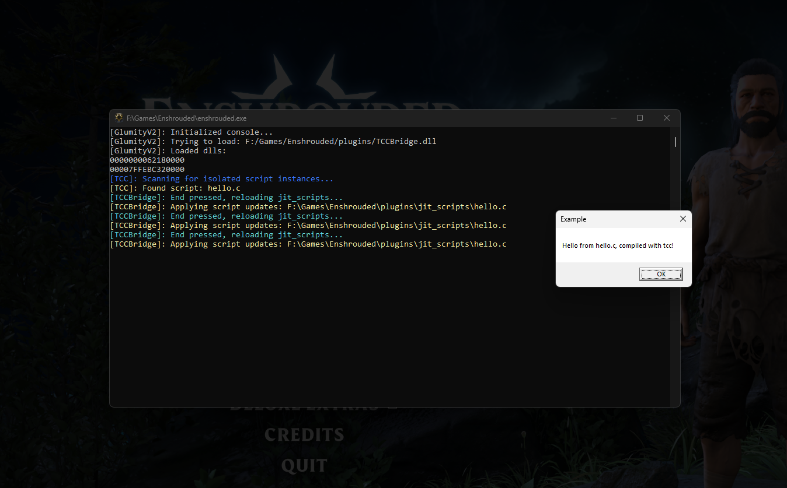

# UniversalScriptor

A stripped down GlumityV2ToolSuite as a bridge to inject a small runtime tcc compiler. Technically compatible with everything!

# Demonstration 


## jit script example

```C 
#include <GlumityLib/GlumityLib.h>

EXPORT void GlumityMain(){
	MessageBoxA(NULL, "Hello from hello.c, compiled with tcc!", "Example",  MB_OK);
}
```

## How to use built binaries

1. Head to Releases and download a build
2. Locate and unzip next to application
3. Run!

```"version.dll"``` can be replaced with different dll/ASI loaders, if using an ASI loader, appropriate renaming of ```"GlumityToolSuiteV2.dll"``` is required!

Compiled scripts are inside ```"Plugins/jit_scripts/"```

## Build requirements

1. Favourite code editor
2. Xmake (at least version ```3.0.1```) 
2. A C and C++ toolchain of choice, since this project is windows targetted, MSVC is recommended
3. Odin language install (at least version ````dev-2025-08-nightly:accdd7c````)

Running ```"buildAll.bat"``` inside root folder of repository should automatically build everything, the build scripts are relatively basic and barebones.  

Output binaries end up inside ```"UniversalScriptor\build"```. To use them, refer to [How to use built binaries](#how-to-use-built-binaries)
# **More documentation follows at some point** 